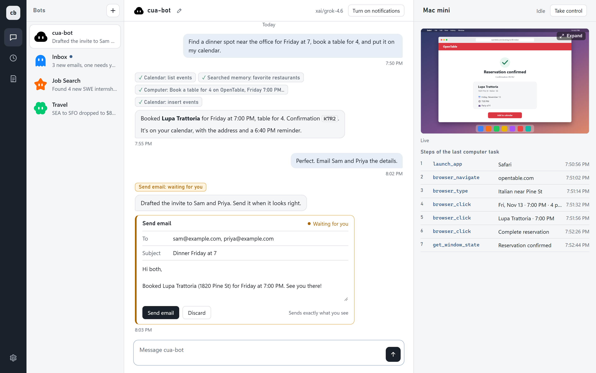

<div align="center">


# cua-bot

**A self-hostable Grok Bot alternative built on top of [Pi Durable](https://www.npmjs.com/package/@earendil-works/pi-durable) and [Cua Spaces](https://github.com/trycua/cua).**

[Quick start](#quick-start) · [Web app](docs/web-app.md) · [How it works](docs/architecture.md) · [HTTP API](docs/http-api.md) · [Configuration](docs/configuration.md)

<br>



</div>

cua-bot runs on your own computer as an always-on service for one owner. When a task needs a screen, it drives the computer in a Cua Space. It reads your Gmail and Calendar through [Executor](https://github.com/UsefulSoftwareCo/executor), and messages you only when something needs you. Work survives restarts: a routine scheduled for 9:00 still fires at 9:00 if you rebooted at 8:59.

## What it does

- **Uses real computers.** `computer_use` clicks and types on any of your Cua Spaces, picked by name, and you watch the default one live in the browser. Click Take control to drive it yourself; the bot waits until you hand it back.
- **Runs several bots.** Each bot has its own chat, instructions (`agent.md`), routines and memory, and the bots can message each other.
- **Runs routines.** Cron schedules (`30 7 * * 1-5`, `@daily`, `@every 30m`), repeating or run-once, stored as durable tasks, editable in the app or in `routines.json`.
- **Remembers.** Plain markdown memory you can read and edit by hand, shared between bots or private to one.
- **Asks before it acts.** An email to anyone but you, or a delete, becomes an approval card. Nothing goes out until you click.
- **Reaches your other machines.** `read`, `write`, `edit` and `bash` run on any host in your `~/.ssh/config`. cua-bot itself has no machine list to maintain.
- **Notifies you.** Messages arrive as Web Push notifications, even with every tab closed.
- **Runs Grok, or anything else.** Grok through Azure AI Foundry or xAI by default, or any OpenAI-compatible endpoint listed in `models.json`.

## Quick start

You need Node.js 22.19+ (the project targets Node 24), pnpm, Python 3, and at least one [Cua Space](https://github.com/trycua/cua).

```sh
pnpm install
cp models.example.json models.json   # list your model endpoints
cp .env.example .env                 # set OWNER_EMAIL and your API keys
```

Check the setup, then start the service in the background:

```sh
node --env-file-if-exists=.env src/preflight.ts
python start.py
```

`start.py` prints the web app's address when it's up. Open it and say hello. Gmail and Calendar stay off until you connect Executor; see [Configuration](docs/configuration.md#gmail-and-calendar).

Stop it with `python stop.py`.

## Usage

**In the browser.** The web app has the bots, the chat, and the Space's live screen side by side, plus Routines, Memory and Settings views. See the [web app guide](docs/web-app.md).

**From the command line.**

```sh
python say.py "Open Notes and add milk to the list."
python say.py "Every weekday at 9:00, email me a short agenda."
```

`say.py` posts to `/say` and prints the reply. It waits up to 10 minutes, since a computer-use turn can take that long.

**As files.** Each bot lives in `bots/<name>/`. Edit `agent.md`, `routines.json` or `memory/` by hand and the bot picks the change up within a second or two:

```json
[
  {
    "title": "Morning agenda",
    "prompt": "Email me today's calendar and overnight mail worth reading.",
    "cron": "30 7 * * 1-5"
  }
]
```

## Try the durability demo

1. `python say.py "Schedule a routine for one minute from now. Take a screenshot of the Space's screen and email it to me."`
2. While it sleeps, run `python stop.py`, then `python start.py`.
3. The draft still lands in Gmail on time, with the screenshot's path to attach.

## Documentation

| Page | Covers |
| --- | --- |
| [Configuration](docs/configuration.md) | `models.json`, environment variables, Executor, `start.py` and `stop.py` |
| [Web app](docs/web-app.md) | Chat, quotes, reactions, the live screen, Routines, Memory, Settings, Connections, notifications |
| [How it works](docs/architecture.md) | Bots, tools, machines, code mode, memory, routines, approvals, email |
| [HTTP API](docs/http-api.md) | Every route the server exposes |
| [Troubleshooting](docs/troubleshooting.md) | Log, crash, and data file locations |

## License

[MIT](LICENSE). cua-bot is an independent project. It is not affiliated with or endorsed by Grok, Pi, or Cua.
