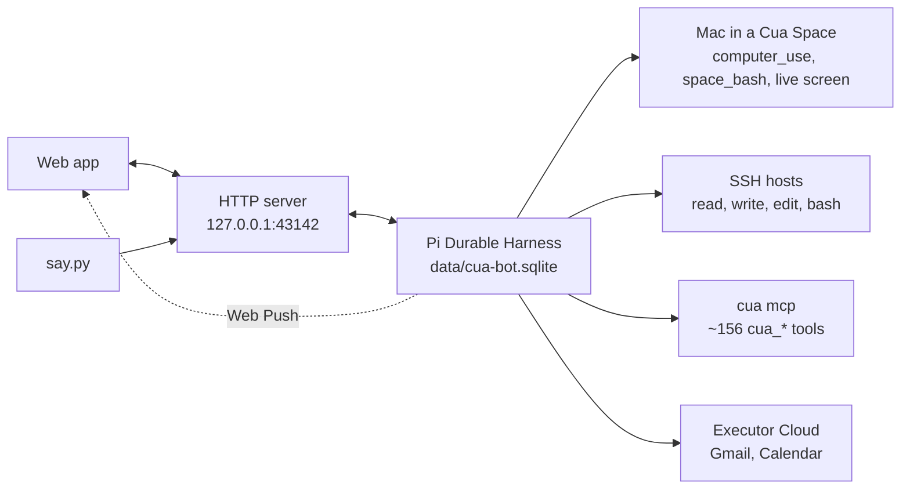

# How it works

[Back to README](../README.md)



`src/main.ts` opens a Pi Durable Harness on `data/cua-bot.sqlite`, resumes unfinished and sleeping work, and serves one HTTP server: `POST /say`, the web app at `/` ([src/app.html](../src/app.html)), and its JSON API under `/api/` ([src/web.ts](../src/web.ts), routes in [HTTP API](http-api.md)).

## Bots

Code: [src/bots.ts](../src/bots.ts).

The owner can run several bots. Each has a name, its own chat, and its own folder.

- **The main bot** (named `cua-bot` until you rename it) is the root conversation. `/say`, and the routines and approval cards from before multi-bot support, belong to it. It can't be deleted.
- **Every other bot** is an ownerless conversation with the same tools, shared memory, accounts and Mac.

The bot list (names, conversation ids, avatars) lives in a session-wide Durable doc, `cua-bot.bots` in `data/cua-bot.sqlite`.

### Bot folders

Everything else a bot owns lives in `bots/<folder>/` in the project root (gitignored). The folder name is the bot's name lowercased, with runs of other characters turned into `-`, so Job Search lives in `bots/job-search/`.

| File | Contents |
| --- | --- |
| `agent.md` | Standing instructions. Plain markdown, no length cap, empty until the bot gets instructions. |
| `routines.json` | Routine definitions, present only while the bot has routines. See [Routines](#routines). |
| `memory/` | The bot's own memory. See [Memory](#memory). |

`agent.md` is re-read on every request, so a hand edit applies on the bot's next turn; the web app picks it up within a second.

Folder rules:

- Renaming a bot moves its folder. A rename onto an existing folder is refused.
- Deleting a bot deletes its folder.
- Creating a bot whose folder you already made by hand adopts that folder.
- A folder whose name matches no bot is ignored.
- Two bots whose names give the same folder aren't allowed.

Each bot's prompt names it, carries its agent file, and lists the other bots. Each other bot is described by the first line of its agent file that isn't blank or a heading.

### Avatars

An avatar is a shape and a color, stored as ids (`avatar: {shape, color}`). The id lists are `AVATAR_SHAPES` (14 shapes) and `AVATAR_COLORS` (11 colors) in `src/bots.ts`, and the server refuses any other id. The drawings are in `src/app.html`. A bot without an avatar, including every bot from before avatars, gets a default derived from its id, so it stays the same across reloads. The main bot's default is black.

### Bot-to-bot messages

- `message_bot` sends to another bot. The message lands in its chat as a `cua-bot.bot-message` entry, shown as "Message from <name>".
- It wakes that bot on a later turn, after any turn in progress. Sending is asynchronous, and a reply comes back the same way.
- Each bot may send at most 20 messages per rolling hour, so two bots can't keep each other awake.
- `create_bot` makes a new bot when the owner asks for one in chat.

An approval card remembers which bot filed it, so it shows in that bot's chat and the outcome goes back to that bot. `computer_use` runs one task at a time across all bots, because they share the one Mac.

## Tools

### Computer use

- **`computer_use`** runs in the foreground as a subagent on the bot's model, with every driver tool the paired Mac lists (59 on cua-driver as of 2026-11-01, including the typed `browser_*` tools, `run_steps` and `run_script`). On-screen work goes here, one task at a time. The main agent can also load any of those driver tools itself with `tool_search`.
- **`space_bash`** runs a shell command on the paired Mac through the Space. The bot calls it directly for CLI tools, files and inspection; `computer_use` has it too.

### Coding tools on every machine

Code: [src/machines.ts](../src/machines.ts), [src/pc.ts](../src/pc.ts).

Pi Durable's `read`, `write`, `edit` and `bash` (Git Bash on Windows), plus `powershell` when cua-bot runs on Windows. Pi Durable doesn't install them on its own; `createMachines()` does.

Each takes an optional `machine` argument:

- **Without it**, the call acts on the computer cua-bot runs on, starting in the owner's home folder (`pcEnv` gives the call a `NodeExecutionEnv`).
- **With it**, `machine` is an SSH destination, resolved by your own `ssh` and `~/.ssh/config` exactly as `ssh <machine>` would (a `Host` alias, or `user@host`). The call runs there through [`@earendil-works/pi-env`](https://www.npmjs.com/package/@earendil-works/pi-env), which deploys its small daemon over SSH on the first call. Paths start in that machine's home folder, and commands run in a login shell, so a Mac's Homebrew is on `PATH`.

cua-bot stores no machine names. The prompt lists the `Host` aliases of your `~/.ssh/config` (patterns skipped, `Include` files not followed), re-read on every request, and the tool schemas are the same for everyone.

Safety and failure behavior:

- A `machine` value that starts with `-` or has whitespace is refused, so it can never reach `ssh` as an option.
- Host keys must already be in `~/.ssh/known_hosts` (connect once with `ssh <machine>`). pi-env checks strictly against that file and never writes to it.
- Nothing connects at startup. A machine that is asleep fails only its own calls (an `ssh` connect timeout, about 40 s), and the next call tries again.
- The bot can't drive the PC's apps; on-screen work stays on the Mac.

One Pi Durable process on the PC owns the session; these tools only reach out to the other machines.

### Code mode

`codemode`, from `@earendil-works/pi-durable/codemode` on `@earendil-works/pi-codemode`'s QuickJS sandbox. The bot writes a JavaScript script that calls its tools as `await tools.<name>(args)`, and only the script's output reaches the model. It suits many calls, loops, or work across machines.

- The script survives a restart.
- Every nested call runs the tool's own code, so a script that sends mail still gets an approval card.
- The Cua tools are grouped as the `cua` namespace for the script's `searchTools()`.

### Cua's MCP tools

Code: [src/cua-mcp.ts](../src/cua-mcp.ts).

At startup the bot launches `cua mcp` (the Cua Spaces app's bundled `cua.exe` on Windows, else `cua` on PATH; `CUA_MCP_COMMAND` overrides) and registers each of its ~156 tools as `cua_<name>`: Spaces and sandboxes, file upload and download, apps and windows, coding agents inside a Space, teleport, hotspot, sharing, volumes.

They are deferred. The bot loads the ones it needs with `tool_search`, so their schemas aren't sent on every turn. If `cua mcp` can't start, the bot logs it and runs without them. `notify_user` is disabled for now (`DISABLED` in that file); every other tool passes through unchanged.

## Memory

Code: [src/memory.ts](../src/memory.ts).

Plain markdown in two kinds of store:

| Store | Path | Seen by |
| --- | --- | --- |
| Shared | `data/memory/` | Every bot |
| Own | `bots/<folder>/memory/` | That bot only |

Each store has `profile.md` for lasting facts and `log/YYYY-MM.md` for dated ones, one fact per line as `- (YYYY-MM-DD) fact`.

- `remember` saves a fact with `scope` `shared` (facts about the owner every bot should know) or `own` (what only this bot's job needs).
- `forget` removes one, and `recall` searches older facts. Both look in the shared store and the bot's own.

Every request carries a memory section with both stores: every profile fact plus the 30 most recent log facts of each, with no length cap. The files are re-read on every request, so hand edits apply at once.

## Routines

Code: [src/routines.ts](../src/routines.ts), [src/routines-file.ts](../src/routines-file.ts), [src/cron.ts](../src/cron.ts).

Tools: `schedule`, `list_routines`, `run_routine`, `cancel_routine`. Each routine is one durable sleeping task.

**Schedules** are a 5-field cron string, a nickname like `@daily`, or `@every 30m`, optionally prefixed `CRON_TZ=Area/City`, parsed with `croner`. The legacy `everyMinutes`/`dailyAt`/`weeklyOn` objects are still accepted and converted.

**Missed runs.** A deadline that passed while the bot was down fires once on restart. Missed slots are not replayed.

**Ownership.** A routine is a task of its bot's conversation and fires as a turn in that bot's chat. A bot's tools see and change only its own routines. At most 50 per bot. Deleting a bot cancels its routines.

### `routines.json`

Each bot's definitions live in `routines.json` in its folder. The chat tools, the web app and hand edits all sync through these files; a watcher applies hand edits within a second or two.

```json
[
  {
    "title": "Morning agenda",
    "prompt": "Email me today's calendar and overnight mail worth reading.",
    "cron": "30 7 * * 1-5"
  }
]
```

- `id` is optional; the bot fills it in.
- The file is the source of truth for its bot's definitions. On start and on every change the service syncs that bot's durable tasks to match: editing a title, prompt or cron replaces that routine's sleeper, and removing an entry cancels it.
- An invalid file (bad JSON, bad cron, duplicate ids, more than 50 entries) is rejected whole. That bot's running routines keep going, the other bots still sync, and the log says why.
- If a bot's file is missing while it has routines, the service recreates it from them instead of deleting them. To cancel them all, empty the file to `[]` or delete them in the app.
- A bot with no routines has no file; removing its last routine deletes it.
- The file moves with its bot's folder on a rename.
- Run history (last fired) stays in the database, not the file.

On the first start after per-bot routines arrived, the old single `routines.json` in the project root moved to the main bot's folder.

## Accounts through Executor

Code: [src/executor.ts](../src/executor.ts).

Gmail, Google Calendar and any other account you connect go through [Executor](https://github.com/UsefulSoftwareCo/executor) Cloud. Executor holds the Google sign-in; the bot holds only an Executor API key and talks to its MCP endpoint:

| Tool | Does |
| --- | --- |
| `executor_search` | Finds a tool and its input type |
| `executor_describe` | Reads its full signature |
| `executor_call` | Runs it |

Executor's `execute` tool (a JavaScript program over every tool) is not given to the bot, so every call goes through a path the bot can check. Call results are fenced as outside data, because other people write the mail and invites.

## Approval cards

Code: [src/approvals.ts](../src/approvals.ts), [src/mime.ts](../src/mime.ts).

These Executor calls don't run. Each becomes a card under the bot's reply instead:

- an operation named send, delete, trash, clear or remove (except mail only to you, below),
- Gmail `modify` with `trash: true`,
- any call Executor itself pauses for approval.

An email card shows the message decoded from what the bot actually wrote, with To, Subject and body editable before sending. Other actions show the bot's one-line summary and the raw call under Details.

Your click runs the call from the server, never from the model. The bot then gets an `[approval]` message with the outcome. When Executor itself holds an approved call, the server accepts the hold, since your click already approved it.

Waiting cards are kept in `data/approvals.json` across restarts and expire after 7 days.

## Email

Executor is the only email path. Bots report to you with `send_message`, which reaches your browser as a notification, and email you only when you ask.

- The bot sends with Executor's `tools.google.gmail.send`, which takes To, Cc, Subject and body as fields and keeps replies in their thread.
- **Mail to you skips the card.** A `tools.google.gmail.send` or `tools.google.gmail.draft` whose every recipient (To, Cc, Bcc) is `OWNER_EMAIL` runs at once, so a routine you asked to email you works on its own. Executor's Google app still holds both tools for approval (`approval: always()` in its `tools/gmail.ts`); for these calls only, the bot accepts that hold itself.
- A reply with no To still gets a card, since it goes to the original sender.
- **No attachments.** Executor's Gmail send can't attach files. When an email should carry a screenshot, the bot saves it as a Gmail draft with `tools.google.gmail.draft` and tells you which files under `data/shots/` to attach.

**Known issue (2026-10-31).** The raw Gmail API send (`tools.google.api.gmail…MessagesSend`) fails with HTTP 400, because Executor posts the upload to Gmail's non-upload URL. Cards still decode it, but use the field send.
