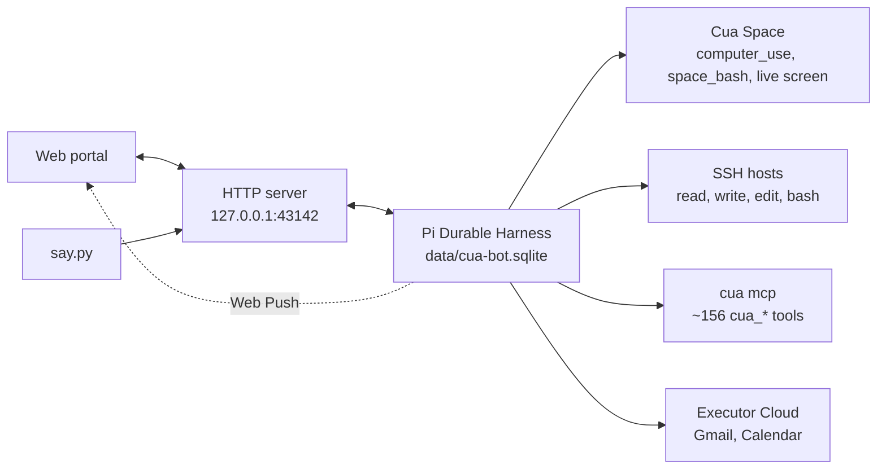

# How it works

[Back to README](../README.md)



`src/main.ts` opens a Pi Durable Harness on `data/cua-bot.sqlite`, resumes unfinished and sleeping work, and serves one HTTP server: `POST /say`, the web portal at `/` ([src/app.html](../src/app.html)), and its JSON API under `/api/` ([src/web.ts](../src/web.ts), routes in [HTTP API](http-api.md)).

## Bots

Code: [src/bots.ts](../src/bots.ts).

The owner can run several bots. Each has a name, its own chat, and its own folder.

- **The main bot** (named `cua-bot` until you rename it) is the root conversation. `/say`, and the routines and approval cards from before multi-bot support, belong to it. It can't be deleted.
- **Every other bot** is an ownerless conversation with the same tools, accounts and Space, and shares memory by tag.

The bot list (names, conversation ids, avatars) lives in a session-wide Durable doc, `cua-bot.bots` in `data/cua-bot.sqlite`.

### Bot folders

Everything else a bot owns lives in `bots/<folder>/` in the project root (gitignored). The folder name is the bot's name lowercased, with runs of other characters turned into `-`, so Job Search lives in `bots/job-search/`.

| File | Contents |
| --- | --- |
| `agent.md` | Standing instructions. Plain markdown, no length cap, empty until the bot gets instructions. |
| `routines.json` | Routine definitions, present only while the bot has routines. See [Routines](#routines). |

`agent.md` is re-read on every request, so a hand edit applies on the bot's next turn; the web portal picks it up within a second.

Folder rules:

- Renaming a bot moves its folder. A rename onto an existing folder is refused.
- Deleting a bot deletes its folder.
- Creating a bot whose folder you already made by hand adopts that folder.
- A folder whose name matches no bot is ignored.
- Two bots whose names give the same folder aren't allowed.

Each bot's prompt names it, carries its agent file, and lists the other bots. Each other bot is described by the first line of its agent file that isn't blank or a heading.

### Avatars

An avatar is a shape and a color, stored as ids (`avatar: {shape, color}`). The id lists are `AVATAR_SHAPES` (14 shapes) and `AVATAR_COLORS` (11 colors) in `src/bots.ts`, and the server refuses any other id. The drawings are in `src/app.html`. A bot without an avatar, including every bot from before avatars, gets a default derived from its id, so it stays the same across reloads. The main bot's default is black.

### Bot-to-bot messages

- `message_bot` sends to another bot. The message lands in its chat as a `cua-bot.bot-message` entry, shown as "Message from <name>".
- It wakes that bot on a later turn, after any turn in progress. Sending is asynchronous, and a reply comes back the same way.
- Each bot may send at most 20 messages per rolling hour, so two bots can't keep each other awake.
- `create_bot` makes a new bot when the owner asks for one in chat.

An approval card remembers which bot filed it, so it shows in that bot's chat and the outcome goes back to that bot. `computer_use` runs one task at a time on each Space across all bots, because bots on the same Space share its screen.

## Tools

### Computer use

Code: [src/computer.ts](../src/computer.ts).

The bots work on every Space your Cua account lists, the way `cua mcp`'s `list_spaces` shows them: Spaces you added, and computers the Cua Spaces app shares over the relay, such as the one cua-bot runs on. The SDK runtime signs in with your `cua auth login` session to open the relay ones. A relay Space on the same network still connects directly; the relay only finds it. The prompt lists each Space's name, system and id on every request, and marks the default (`CUA_SPACE_ID`, else the first in `~/.cua/spaces.json`).

- **`computer_use`** runs in the foreground as a subagent on the calling bot's model and reasoning effort, with every driver tool the chosen Space lists (60 on the Mac's cua-driver and 61 on Windows as of 2026-11-07, including the typed `browser_*` tools, `run_steps` and `run_script`). On-screen work goes here, one task at a time on each Space.
- **`space_bash`** runs a shell command on a Space (`/bin/sh -c`, or `cmd.exe /C` on a Windows Space). The bot calls it directly for CLI tools, files and inspection; `computer_use` has it too.

Both take `space`, a Space's name (any case) or its id. Without it they use the default; inside `computer_use`, `space_bash` uses the task's Space. A bot can switch Spaces between calls in one job.

Each Space's driver tools sit in their own extension, `space:<id>`, installed by that Space's first `computer_use` call, because a Mac and a Windows PC both have a `click` with different schemas. Only that Space's child selects the extension. The main agent never gets driver tools: `tool_search` skips them and code mode can't call them. To call one driver tool directly, a bot uses `cua_call_tool` with the Space's id.

The live screen and Take control stay on the default Space. Owner control pauses only that Space's driver calls.

### Coding tools on every machine

Code: [src/machines.ts](../src/machines.ts), [src/pc.ts](../src/pc.ts).

Pi Durable's `read`, `write`, `edit` and `bash` (Git Bash on Windows), plus `powershell` when cua-bot runs on Windows. Pi Durable doesn't install them on its own; `createMachines()` does.

Each takes an optional `machine` argument:

- **Without it**, the call acts on the computer cua-bot runs on, starting in the owner's home folder (`pcEnv` gives the call a `NodeExecutionEnv`).
- **With it**, `machine` is an SSH destination, resolved by your own `ssh` and `~/.ssh/config` exactly as `ssh <machine>` would (a `Host` alias, or `user@host`). The call runs there through [`@earendil-works/pi-env`](https://www.npmjs.com/package/@earendil-works/pi-env), which deploys its small daemon over SSH on the first call. Paths start in that machine's home folder, and commands run in a login shell, so, for example, Homebrew is on `PATH` on a Mac.

cua-bot stores no machine names. The prompt lists the `Host` aliases of your `~/.ssh/config` (patterns skipped, `Include` files not followed), re-read on every request, and the tool schemas are the same for everyone.

Safety and failure behavior:

- A `machine` value that starts with `-` or has whitespace is refused, so it can never reach `ssh` as an option.
- Host keys must already be in `~/.ssh/known_hosts` (connect once with `ssh <machine>`). pi-env checks strictly against that file and never writes to it.
- Nothing connects at startup. A machine that is asleep fails only its own calls (an `ssh` connect timeout, about 40 s), and the next call tries again.
- These tools have no screen. On-screen work goes through `computer_use` on the Space.

One Pi Durable process on the computer cua-bot runs on owns the session; these tools only reach out to the other machines.

### Code mode

`codemode`, from `@earendil-works/pi-durable/codemode` on `@earendil-works/pi-codemode`'s QuickJS sandbox. The bot writes a JavaScript script that calls its tools as `await tools.<name>(args)`, and only the script's output reaches the model. It suits many calls, loops, or work across machines.

- The script survives a restart.
- Every nested call runs the tool's own code, so a script that sends mail still gets an approval card.
- The Cua tools are grouped as the `cua` namespace for the script's `searchTools()`.

### Cua's MCP tools

Code: [src/cua-mcp.ts](../src/cua-mcp.ts).

At startup the bot launches `cua mcp` (the Cua Spaces app's bundled `cua.exe` on Windows, else `cua` on PATH; `CUA_MCP_COMMAND` overrides) and registers each of its ~156 tools as `cua_<name>`: Spaces and sandboxes, file upload and download, apps and windows, coding agents inside a Space, teleport, hotspot, sharing, volumes.

They are deferred. The bot loads the ones it needs with `tool_search`, so their schemas aren't sent on every turn. If `cua mcp` can't start, the bot logs it and runs without them. `notify_user` is disabled for now (`DISABLED` in that file); every other tool passes through unchanged.

## Memory

Code: [src/memory.ts](../src/memory.ts).

Plain markdown in one store, `data/memory/`: `profile.md` for lasting facts and `log/YYYY-MM.md` for dated ones, one fact per line as `- (YYYY-MM-DD) [tag, tag] fact`. A fact's tags say which bots get it:

| Tag | Reaches | Where it comes from |
| --- | --- | --- |
| `every-bot` | Every bot, including future ones | Built in |
| `@<folder>`, such as `@job-search` | That bot | Each bot has one |
| Any other, such as `job-bots` | The bots listed for it | `tags.json`, edited in Settings > Memory tags |

A line with no tag, or only tags that name nothing, reaches no bot and shows under Untagged in the web portal. Renaming a bot or one of your tags rewrites its facts. Deleting either takes the tag off; a fact left with no tag stays, under Untagged.

Memory holds facts about the owner and their standing instructions. It is not a bot's work log: the memory section tells each bot to keep what it did, sent, checked or relayed, the status of what it tracks, and the owner's decisions on those items in `work-log.md` in its own folder, one line each as `- (YYYY-MM-DD) what happened`, newest last. A bot reads that file itself when the work comes up, and with Jev on, the lines that bear on a message arrive with it (below).

- `remember` saves a fact with `tags`. Saving text a tier already has adds the tags to that fact. Its answer lists the similar facts the bot can already see (every fact, for the main bot), so the bot can merge or correct at the moment it writes.
- `forget` removes a fact and `search_memory` searches by one or more keywords, both only among facts the bot can see. A keyword matches at the start of a word, or anywhere in text like Chinese that has no spaces. `forget` removes the text from both tiers unless given `tier`.
- The main bot manages every fact, whichever bots it is for. `list_memory` shows them all, followed by the groups of similar facts. `change_memory` takes a list of changes and applies them in order: each names a fact by its exact text and tier and gives `to` (new wording, same date and tags), `tags` (new tags), both, or `forget: true`. Its `forget` can remove any fact too. These tools change what it can reach, not what it is given. Its memory section and automatic searches still follow its tags, as `search_memory` does.

**Similar facts** are likely the same fact twice, or two that conflict. Two facts are similar when they share at least 60% of the keywords of the one with fewer, and at least two. A fact's keywords are its words that at most one in ten of the facts compared contain, so nothing is similar among ten facts or fewer.

**Backups.** `change_memory` copies the whole store to `data/memory-backups/<YYYY-MM-DD>-<HHMMSS>-<ms>/` before it changes anything, and its answer and `data/logs/cua-bot.log` name that folder and list every change. If the copy fails, nothing changes. A name in the batch that isn't a tag also stops the call before the copy. A change that can't apply, such as a fact that isn't there, is reported and skipped while the rest apply. Edits in the web portal are not backed up.

To have the main bot tidy memory every night, give it a routine like this one. It is an ordinary routine, edited in the Routines view.

> Organize all saved memory. Call list_memory once and read every fact, whichever bots it is for, then the groups of similar facts after the list. Decide every change before making any, then make them all in one change_memory call, which backs the store up first. Merge duplicates and near-duplicates into one fact: reword the one you keep, give it the combined tags, and forget the others. Forget facts that are plainly outdated or that a newer fact contradicts. Reword unclear facts. Retag facts so each reaches only the bots that need it. To move a lasting fact from log to profile, remember it in profile first, then forget its log copy in the same change_memory call. Keep anything you are unsure about, and add no new information. Finish with a short list of what you changed as your reply, or No changes.

Every request carries a memory section with the list of tags, every profile fact the bot can see, and the 30 most recent log facts it can see, with no length cap. The files are re-read on every request, so hand edits apply at once. Tags decide what a bot is given and what `search_memory` returns; they aren't a security boundary, since bots with file tools can read the files.

Each message from the owner or another bot also searches, automatically, the log facts older than those 30, which are the only facts the bot can see that its memory section doesn't show. The message's own words are the keywords. A word counts only if at most one in ten of the facts the bot can see contains it, which drops words like "the" and "owner". Matches go in the transcript as a `cua-bot.memory-note` entry just before the message: the bot reads it, the chat doesn't show it, and the log records the keywords. A message that only matches facts already in the section adds no note. Routine firings aren't searched, since a routine sends the same text every time.

**Jev instead of keywords.** Code: [src/jev.ts](../src/jev.ts). With `TYPESAFE_API_KEY` in `.env`, [Jev](https://docs.typesafe.ai/), TypeSafe AI's decision model, picks those older facts and keywords play no part. It also picks from the receiving bot's work log: every line of `bots/<folder>/work-log.md` that starts with a dash. One request per message carries the message and one yes/no question per older log fact and per work-log line; Jev answers each with a probability and generates no text. Those at 0.7 or higher go in the note, most likely first, at most 20 facts and 20 work-log lines. This sends each incoming message, those facts and that bot's work log to `api.typesafe.ai`. The whole work log is judged for every message, so the request and what TypeSafe bills for it grow with the log. A request too long for Jev (about 32,000 tokens) is split in half until it fits. A bot with 30 or fewer log facts and no work log has nothing to judge, so no request is made for it. When a request fails, that message gets no note, keyword search does not step in, and the log has a `memory: no note for this message` line with the reason. TypeSafe's client gives each attempt 10 seconds and retries twice, so an unreachable API can hold a message for about half a minute before it goes on without a note. The log's startup line `memory: what a message brings up is picked by ...` says which of the two is on. Without a key, work logs are not searched; keyword search proved too noisy on them.

An install from before tags moves over once at startup (`migrateMemory`): shared facts get `every-bot`, each `bots/<folder>/memory/` fact gets `@<folder>`, and the same text in a tier becomes one fact with both tags and the earliest date. The old files are copied to `data/memory-backup-pre-tags/` first.

## Routines

Code: [src/routines.ts](../src/routines.ts), [src/routines-file.ts](../src/routines-file.ts), [src/cron.ts](../src/cron.ts).

Tools: `schedule`, `list_routines`, `run_routine`, `cancel_routine`. Each routine is one durable sleeping task.

**Schedules** are a 5-field cron string, a nickname like `@daily`, or `@every 30m`, optionally prefixed `CRON_TZ=Area/City`, parsed with `croner`. The legacy `everyMinutes`/`dailyAt`/`weeklyOn` objects are still accepted and converted.

**Missed runs.** A deadline that passed while the bot was down fires once on restart. Missed slots are not replayed.

**One-time routines.** A routine with `once: true` fires at its next slot and is then removed from the database and `routines.json`, without the model doing anything. Removal happens as soon as the turn is queued, because a firing never waits for the answer, so a turn that fails is not retried. Cron has no year, so `0 12 9 11 *` with `once` means the next Nov 9 at 12:00. Run now does not use it up.

**Ownership.** A routine is a task of its bot's conversation and fires as a turn in that bot's chat. A bot's tools see and change only its own routines. At most 50 per bot. Deleting a bot cancels its routines.

### `routines.json`

Each bot's definitions live in `routines.json` in its folder. The chat tools, the web portal and hand edits all sync through these files; a watcher applies hand edits within a second or two.

```json
[
  {
    "title": "Morning agenda",
    "prompt": "Email me today's calendar and overnight mail worth reading.",
    "cron": "30 7 * * 1-5"
  }
]
```

- `id` is optional; the bot fills it in.
- `once` is optional; `true` makes it a one-time routine.
- The file is the source of truth for its bot's definitions. On start and on every change the service syncs that bot's durable tasks to match: editing a title, prompt, cron or `once` replaces that routine's sleeper, and removing an entry cancels it.
- An invalid file (bad JSON, bad cron, a non-boolean `once`, duplicate ids, more than 50 entries) is rejected whole. That bot's running routines keep going, the other bots still sync, and the log says why.
- If a bot's file is missing while it has routines, the service recreates it from them instead of deleting them. To cancel them all, empty the file to `[]` or delete them in the web portal.
- A bot with no routines has no file; removing its last routine deletes it.
- The file moves with its bot's folder on a rename.
- Run history (last fired) stays in the database, not the file.

On the first start after per-bot routines arrived, the old single `routines.json` in the project root moved to the main bot's folder.

## Accounts through Executor

Code: [src/executor.ts](../src/executor.ts).

Gmail, Google Calendar and any other account you connect go through [Executor](https://github.com/UsefulSoftwareCo/executor) Cloud. Executor holds the Google sign-in; the bot holds only an Executor API key and talks to its MCP endpoint:

| Tool | Does |
| --- | --- |
| `executor_search` | Finds a tool and its input type |
| `executor_describe` | Reads its full signature |
| `executor_call` | Runs it |

Executor's `execute` tool (a JavaScript program over every tool) is not given to the bot, so every call goes through a path the bot can check. Call results are fenced as outside data, because other people write the mail and invites.

## Approval cards

Code: [src/approvals.ts](../src/approvals.ts), [src/mime.ts](../src/mime.ts).

These Executor calls don't run. Each becomes a card under the bot's reply instead:

- an operation named send, delete, trash, clear or remove (except mail only to you, below),
- Gmail `modify` with `trash: true`,
- any call Executor itself pauses for approval.

An email card shows the message decoded from what the bot actually wrote, with To, Subject and body editable before sending. Other actions show the bot's one-line summary if it wrote one, and always a row for each value in the call, read from the call itself. A Gmail `modify` card replaces thread ids with each thread's subject and sender, looked up through Executor after the card appears; those subjects stay out of what the bot is told, since outside parties write them. The raw call is under Details.

Your click runs the call from the server, never from the model. The bot then gets an `[approval]` message with the outcome. When Executor itself holds an approved call, the server accepts the hold, since your click already approved it.

Waiting cards are kept in `data/approvals.json` across restarts and expire after 7 days. Executor's own hold lasts about 15 minutes, so approving a card after that runs the call again and accepts the new hold. Executor holds a tool before it acts, and an expired hold was never answered, so the action hasn't happened yet. Any other reason a hold is gone fails the card with Executor's message.

## Email

Executor is the only email path. Bots report to you with `send_message`, which reaches your browser as a notification, and email you only when you ask.

- The bot sends with Executor's `tools.google.gmail.send`, which takes To, Cc, Subject and body as fields and keeps replies in their thread.
- **Mail to you skips the card.** A `tools.google.gmail.send` or `tools.google.gmail.draft` whose every recipient (To, Cc, Bcc) is `OWNER_EMAIL` runs at once, so a routine you asked to email you works on its own. Executor's Google app still holds both tools for approval (`approval: always()` in its `tools/gmail.ts`); for these calls only, the bot accepts that hold itself.
- A reply with no To still gets a card, since it goes to the original sender.
- **Gmail labels can skip the card.** With Settings > Approvals on, a `tools.google.gmail.modify` that only adds or removes your own labels runs at once, and the bot accepts Executor's hold itself. Any other field on the call, or a built-in label such as `TRASH` or `INBOX`, still gets a card, because those move, hide or delete mail.
- **No attachments.** Executor's Gmail send can't attach files. When an email should carry a screenshot, the bot saves it as a Gmail draft with `tools.google.gmail.draft` and tells you which files under `data/shots/` to attach.

**Known issue (2026-10-31).** The raw Gmail API send (`tools.google.api.gmail…MessagesSend`) fails with HTTP 400, because Executor posts the upload to Gmail's non-upload URL. Cards still decode it, but use the field send.
